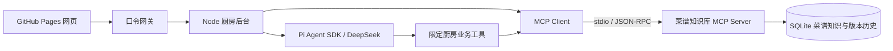

# 买汰烧：Agent、Skill 与菜谱知识库

## 当前调用关系



Pi Web 是本机模型配置与调试入口。厨房后台通过 Pi SDK 调用模型，无需保持 Pi Web 页面打开。后台、知识库和 SQLite 仍在主厨电脑；GitHub Pages 只放前端。

## 网页如何维护知识

左侧「菜谱知识库」提供关键词搜索、手动添加、助手整理、编辑知识和历史版本。保存途径均调用 MCP，查询结果也是 MCP 返回。支持菜名、食材、用量、类别、基础份数、过敏来源、步骤、口味标签和来源说明。

- 新菜先进入草稿，核对入库后才参与排菜。
- 已确认菜谱可以编辑，保留稳定 ID，每次实质修改递增知识版本并保存旧内容。
- 旧菜单的餐次和菜谱 ID 保留；菜谱详情、后续排菜、采购会读取当前知识。历史知识可查，但当前并未将历史菜单冻结绑定到旧菜谱版本。
- 草稿不会进入候选；过敏与忌口校验仍在排菜服务中执行。修改过敏标签后，已有菜单会重新显示冲突。
- 数据修订号与菜谱知识版本共同防止覆盖他人的新修改。

当前是结构化、关键词可检索的知识库，不包含向量索引或未经核实的精确营养数据库。EveryDay_Food 仍只完成评估，没有批量导入。

## 对话修改

明确指令默认直接保存，完成后回复实际改动。内部仍先试排或预览并校验，避免模型只口头说“已修改”。用户明确说“先预览”“先别保存”“等我确认”才生成待确认卡片；指代、日期或修改范围不清时先询问。

支持成员姓名、年龄、性别、饭量、辣度、标签、过敏、喜好、忌口、健康备注、固定七天规律；同时支持排菜设置、菜谱知识、午餐草稿和待接入资料。新增标签与移除标签分别处理，未提到的字段保留。疾病备注不自动推导禁食。临时某餐安排不覆盖固定规律。

菜单仍可从原有撤销入口恢复。上传新头像、图片识别及来源链接使用对应页面入口；API Key 和模型连接配置仍仅在本机设置。规则资料只保存为待接入，不自动执行文档中的要求。

## 实际工具与 MCP

| 层级 | 名称 | 职责 |
| --- | --- | --- |
| Pi 工具 | `get_kitchen_context` | 家庭、规则、选定周菜单、可编辑草稿和设置 |
| Pi 工具 | `find_recipes` | 经 MCP 查询已确认菜谱知识 |
| Pi 工具 | `preview_menu_adjustment` | 内部试排与约束校验 |
| Pi 工具 | `preview_kitchen_update` | 内部检查字段修改及菜单影响 |
| Pi 工具 | `get_shopping_list` | 采购计算 |
| 导入工具 | `read_source_image` | 按当前文章的图片索引读取菜单图 |
| MCP 工具 | `knowledge_search_recipes` | 结构化知识查询 |
| MCP 工具 | `knowledge_recipe_history` | 菜谱版本历史 |
| MCP 工具 | `knowledge_save_recipe` | 网页表单保存、草稿确认、已确认菜谱更新 |
| MCP 工具 | `knowledge_confirm_proposal` | 应用用户特意要求预览后的菜谱建议 |
| MCP 工具 | `knowledge_apply_chat_update` | 明确指令直接保存知识及关联资料，连同执行记录原子提交 |

MCP 写工具由厨房后台按已校验请求调用，不直接交给 Pi 自由提交。Pi 不加载 bash、文件编辑等编码工具。

知识库 MCP 的独立启动命令：

```powershell
node D:/FDE培训/family-kitchen/server/knowledge-mcp.mjs D:/FDE培训/family-kitchen/data/kitchen.sqlite
```

stdio 接口面向 MCP 客户端，标准输出只用于协议；日常启动厨房时后台会自动启动对应子进程，无需另开终端。使用官方 `@modelcontextprotocol/sdk` 1.32.2，连接方式参考 [官方客户端文档](https://ts.sdk.modelcontextprotocol.io/client) 与 [服务端文档](https://ts.sdk.modelcontextprotocol.io/server)。

## “生成菜单就是 Skill 吗？”

从产品能力看，它是“菜单规划能力”，可以封装成 Skill。但当前实际实现为 Pi 理解需求、调用厨房工具、服务端排菜与规则校验、数据库保存，并非由独立 `SKILL.md` 驱动。`server/pi-agent.mjs` 明确设置 `noSkills: true`；规则 JSON、知识库、MCP 工具与 Skill 是不同层。

开发这套项目用到的辅助 Skills 包括 UI/UX 设计与前端适配的 `ui-ux-pro-max`、生成角色图片的 `imagegen`、阅读规则 Word 文档的 `documents`、共享隧道相关的 `cloudflare-one`，以及安装技能的 `skill-installer`。`grill-me` 与 `grilling` 已安装，属于需求讨论工具，没有作为产品的排菜引擎运行。

头像使用内置 imagegen；输出路径与提示词见 [形象素材说明](形象素材说明.md)。这些开发 Skills 不会因为安装在 Codex 中就自动出现在产品 Pi 的运行环境。
